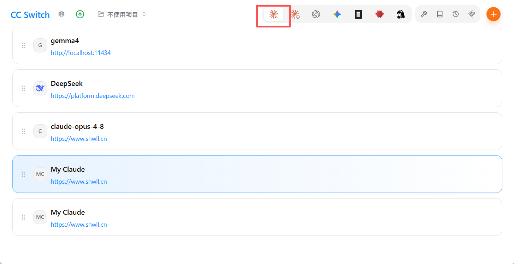
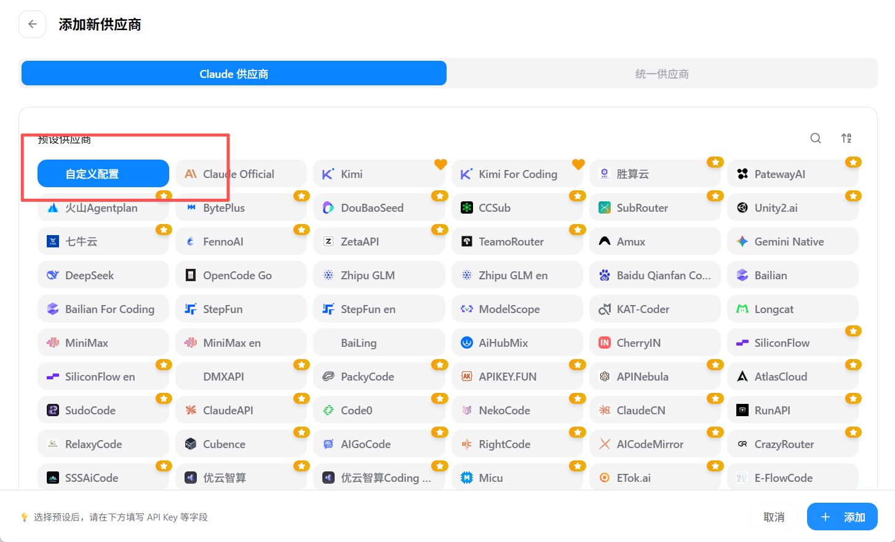
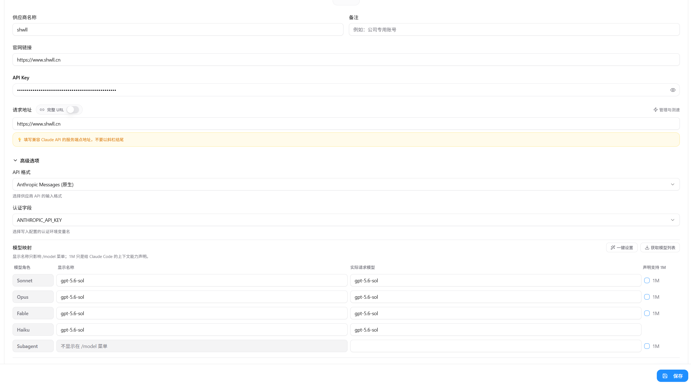
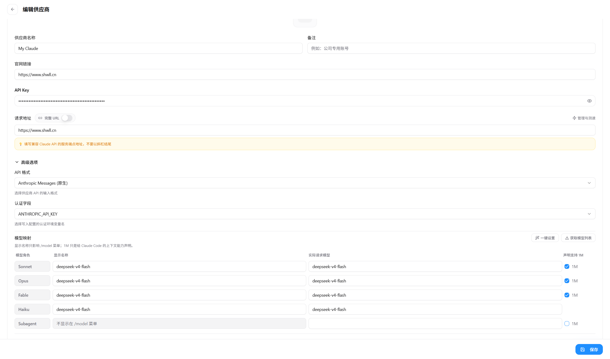
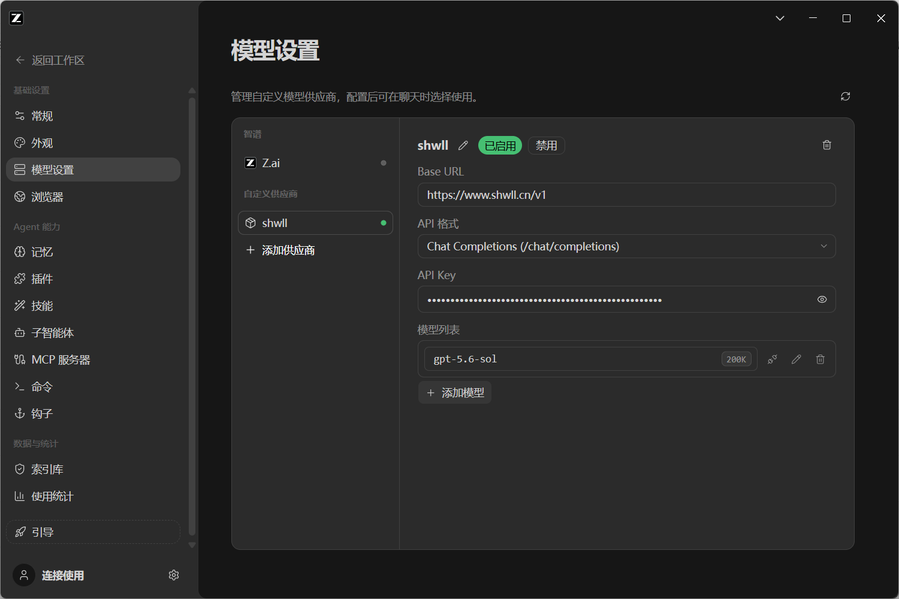
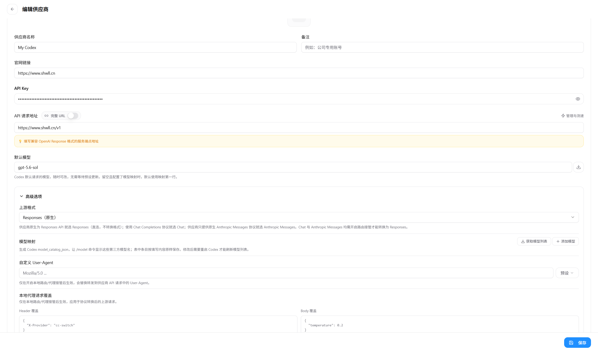
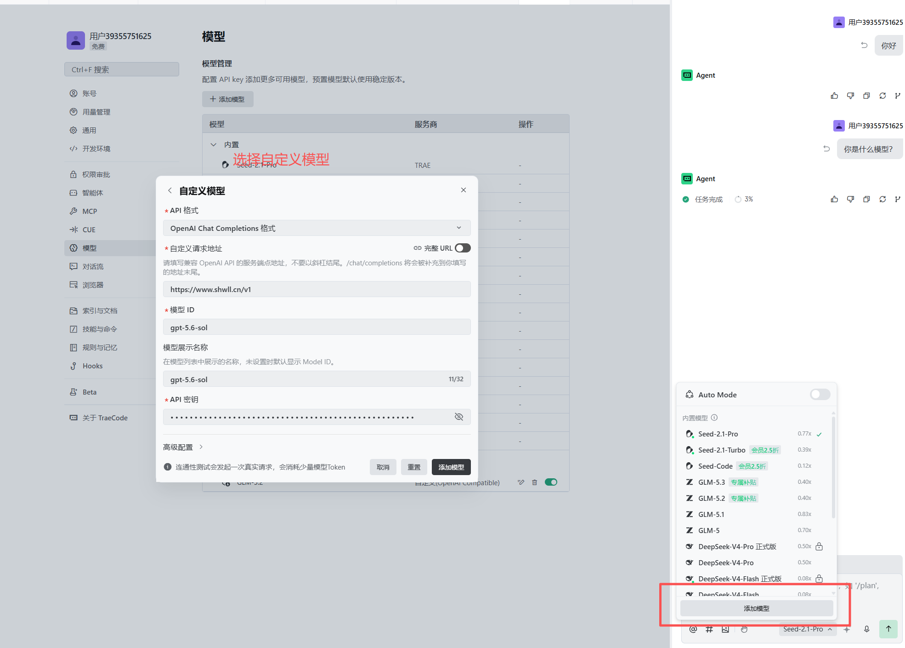

# ShwllAPI 使用文档

本站是一个聚合多家 AI 大模型供应商的 API 中转/网关服务，对外提供统一的 **OpenAI**、**Claude（Anthropic）**、**Gemini** 三种接口格式。

你只需一个 `sk-` 开头的令牌（API Key），即可在几乎所有支持自定义接口的客户端、SDK、编程语言中调用 Claude、GPT、Gemini 等模型。

---

## 目录

- [一、基础信息](#一基础信息)
- [二、获取与查询令牌](#二获取与查询令牌)
- [三、Claude Code 接入（使用 cc-switch 配置）](#三claude-code-接入使用-cc-switch-配置)
- [四、cc-switch 接入（多配置切换）](#四cc-switch-接入多配置切换)
- [五、直接 API 调用（curl）](#五直接-api-调用curl)
- [六、Python SDK](#六python-sdk)
- [七、Node.js SDK](#七nodejs-sdk)
- [八、Kimi Code 接入](#八kimi-code-接入)
- [九、ZCode 接入](#九zcode-接入)
- [十、WorkBuddy 接入](#十workbuddy-接入)
- [十一、CodeBuddy 接入](#十一codebuddy-接入)
- [十二、VSCode 接入（Continue / Cline）](#十二vscode-接入continue--cline)
- [十三、ChatGPT 桌面版接入](#十三chatgpt-桌面版接入)
- [十四、Cursor 编辑器](#十四cursor-编辑器)
- [十五、TRAE 接入](#十五trae-接入)
- [十六、查看可用模型](#十六查看可用模型)
- [十七、常见问题 FAQ](#十七常见问题-faq)

---

## 一、基础信息

| 项目                 | 值                                         |
| -------------------- | ------------------------------------------ |
| Base URL（服务地址） | `https://www.shwll.cn`                     |
| 令牌查询页           | `https://www.shwll.cn/token/query`         |
| OpenAI 格式接口      | `https://www.shwll.cn/v1/chat/completions` |
| Claude 格式接口      | `https://www.shwll.cn/v1/messages`         |
| Gemini 格式接口      | `https://www.shwll.cn/v1beta/models`       |
| 模型列表接口         | `https://www.shwll.cn/v1/models`           |
| 鉴权方式             | 请求头 `Authorization: Bearer sk-你的令牌` |

> 提示：
>
> - Base URL 末尾不要加 `/v1`，`/v1` 由各客户端 / SDK 按需自动拼接。
> - 少数客户端（如部分老版本 OpenAI 客户端）要求 Base URL 直接填到 `/v1`，请参考对应章节的说明。
> - **是否带 `/v1` 的判断技巧**：客户端 Base URL 配置项的提示文案若写着「例如 `https://api.openai.com/v1`」，就带 `/v1`；若写着「例如 `https://api.openai.com`」，就不带。也可两种都试，能拉到模型列表的那个就是对的。

**支持的接口格式一览：**

| 格式               | 路径                                                                                                                                                   | 适用客户端                                                                      |
| ------------------ | ------------------------------------------------------------------------------------------------------------------------------------------------------ | ------------------------------------------------------------------------------- |
| OpenAI             | `/v1/chat/completions`、`/v1/completions`、`/v1/embeddings`、`/v1/images/generations`、`/v1/audio/*`、`/v1/responses`、`/v1/rerank`、`/v1/moderations` | Kimi Code、ZCode、WorkBuddy、CodeBuddy、VSCode（Continue/Cline）、OpenAI SDK 等 |
| Claude (Anthropic) | `/v1/messages`                                                                                                                                         | Claude Code、Anthropic SDK 等                                                   |
| Gemini             | `/v1beta/models/{model}:generateContent`                                                                                                               | Google SDK、部分支持 Gemini 的客户端                                            |

**鉴权请求头**（三种任选其一，效果相同）：

```
Authorization: Bearer sk-你的令牌        # 通用，推荐
x-api-key: sk-你的令牌                   # Anthropic 风格
x-goog-api-key: sk-你的令牌              # Gemini 风格
```

---

## 二、获取与查询令牌

### 1. 获取令牌

登录站点控制台 → 「令牌」页面 → 新建令牌 → 复制以 `sk-` 开头的字符串。

令牌即你的 API Key，请妥善保管，泄露后请立即在控制台重置。

### 2. 查询额度与用量

打开 [令牌查询页](https://www.shwll.cn/token/query)：

- 在「服务地址」中填入 `https://www.shwll.cn`（已预填）。
- 在「API Key」中填入你的 `sk-` 令牌。
- 点击「查询」。

即可看到：

- 调用次数、已用额度、估算剩余额度
- 输入 / 输出 Token 统计
- 错误次数、最后调用时间
- 每一条调用明细（模型、用时、额度、是否流式等），支持按类型筛选和关键字搜索

「高级设置」里可调整 QuotaPerUnit（额度单位）和货币符号，用于把额度换算成估算金额。

### 3. 通过 API 查询（可选）

也支持直接调用接口拉取日志，方便集成到自己的脚本：

```bash
curl https://www.shwll.cn/api/log/token \
  -H "Authorization: Bearer sk-你的令牌"
```

返回 JSON 中 `data` 为日志数组，包含 `model_name`、`prompt_tokens`、`completion_tokens`、`quota`、`created_at` 等字段。

---

## 三、Claude Code 接入（使用 cc-switch 配置）

Claude Code 是 Anthropic 官方 CLI。**推荐直接使用 cc-switch 图形化工具来管理并切换配置（见下一节）**：

1. 在 cc-switch 中新增一个供应商配置：Base URL 填 `https://www.shwll.cn`，Token 填你的 `sk-` 令牌。
2. 点击该配置切换为当前生效。
3. 启动 `claude` 即可自动使用本站。

如果你不想用 cc-switch，也可以通过环境变量方式接入：

**macOS / Linux：**

```bash
export ANTHROPIC_BASE_URL=https://www.shwll.cn
export ANTHROPIC_AUTH_TOKEN=sk-你的令牌
claude
```

**Windows PowerShell：**

```powershell
$env:ANTHROPIC_BASE_URL = "https://www.shwll.cn"
$env:ANTHROPIC_AUTH_TOKEN = "sk-你的令牌"
claude
```

> 说明：这里用 `ANTHROPIC_AUTH_TOKEN` 而不是 `ANTHROPIC_API_KEY`。前者以 `Authorization: Bearer` 方式发送，最通用；本站同时也支持 `x-api-key` 方式，因此两者实际都能用，但推荐 `ANTHROPIC_AUTH_TOKEN`。
>
> 选择claude添加新的供应商



添加自定义配置



编辑配置保存重启claude code切换模型即可



---

## 四、cc-switch 接入（多配置切换）

cc-switch 是一个用于管理多套 Claude Code 配置的图形化工具，可一键切换不同的中转站 / 官方账号，免去反复改环境变量。

下载链接：<https://github.com/farion1231/cc-switch/releases>

**配置步骤：**

1. 打开 cc-switch，进入「供应商 / Providers」管理页。
2. 点击「新增 / Add」新建一个配置，按下表填写：

| 字段            | 填写内容                   |
| --------------- | -------------------------- |
| 名称 Name       | 本站（如 `shwll`，自定义） |
| Base URL        | `https://www.shwll.cn`     |
| API Key / Token | `sk-你的令牌`              |

3. 保存后，在配置列表中点击该条目即可切换为当前生效配置。
4. 切换后直接启动 `claude`，会自动应用所选配置。

> cc-switch 本质上是在帮你管理上面第 三 节中的环境变量 / settings.json，所以 Base URL 和 Token 的填写规则与 Claude Code 完全一致。



---

## 五、直接 API 调用（curl）

### 1. OpenAI 格式（聊天补全）

```bash
curl https://www.shwll.cn/v1/chat/completions \
  -H "Authorization: Bearer sk-你的令牌" \
  -H "Content-Type: application/json" \
  -d '{
    "model": "claude-sonnet-4-5",
    "messages": [
      {"role": "user", "content": "你好，请用一句话介绍你自己"}
    ],
    "stream": false
  }'
```

**流式输出（SSE）：**

```bash
curl https://www.shwll.cn/v1/chat/completions \
  -H "Authorization: Bearer sk-你的令牌" \
  -H "Content-Type: application/json" \
  -d '{
    "model": "claude-sonnet-4-5",
    "messages": [{"role": "user", "content": "写一首七言绝句"}],
    "stream": true
  }'
```

### 2. Claude（Anthropic）格式

```bash
curl https://www.shwll.cn/v1/messages \
  -H "x-api-key: sk-你的令牌" \
  -H "anthropic-version: 2023-06-01" \
  -H "content-type: application/json" \
  -d '{
    "model": "claude-sonnet-4-5",
    "max_tokens": 1024,
    "messages": [
      {"role": "user", "content": "你好，请用一句话介绍你自己"}
    ]
  }'
```

> Claude 格式必须带 `anthropic-version` 请求头；`max_tokens` 为必填字段。

### 3. Gemini 格式

```bash
curl "https://www.shwll.cn/v1beta/models/gemini-2.5-pro:generateContent?key=sk-你的令牌" \
  -H "Content-Type: application/json" \
  -d '{
    "contents": [{"parts": [{"text": "你好"}]}]
  }'
```

---

## 六、Python SDK

### 1. OpenAI SDK（推荐，可调所有模型）

```bash
pip install openai
```

```python
from openai import OpenAI

client = OpenAI(
    api_key="sk-你的令牌",
    base_url="https://www.shwll.cn/v1",   # 注意这里带 /v1
)

resp = client.chat.completions.create(
    model="claude-sonnet-4-5",
    messages=[{"role": "user", "content": "你好"}],
)
print(resp.choices[0].message.content)
```

**流式：**

```python
stream = client.chat.completions.create(
    model="claude-sonnet-4-5",
    messages=[{"role": "user", "content": "讲个故事"}],
    stream=True,
)
for chunk in stream:
    delta = chunk.choices[0].delta.content or ""
    print(delta, end="", flush=True)
```

### 2. Anthropic SDK（调 Claude 模型）

```bash
pip install anthropic
```

```python
from anthropic import Anthropic

client = Anthropic(
    api_key="sk-你的令牌",
    base_url="https://www.shwll.cn",       # 注意这里不带 /v1
)

resp = client.messages.create(
    model="claude-sonnet-4-5",
    max_tokens=1024,
    messages=[{"role": "user", "content": "你好"}],
)
print(resp.content[0].text)
```

---

## 七、Node.js SDK

### 1. OpenAI SDK

```bash
npm install openai
```

```js
import OpenAI from 'openai'

const client = new OpenAI({
  apiKey: 'sk-你的令牌',
  baseURL: 'https://www.shwll.cn/v1', // 注意带 /v1
})

const resp = await client.chat.completions.create({
  model: 'claude-sonnet-4-5',
  messages: [{ role: 'user', content: '你好' }],
})
console.log(resp.choices[0].message.content)
```

### 2. Anthropic SDK

```bash
npm install @anthropic-ai/sdk
```

```js
import Anthropic from '@anthropic-ai/sdk'

const client = new Anthropic({
  apiKey: 'sk-你的令牌',
  baseURL: 'https://www.shwll.cn', // 注意不带 /v1
})

const resp = await client.messages.create({
  model: 'claude-sonnet-4-5',
  max_tokens: 1024,
  messages: [{ role: 'user', content: '你好' }],
})
console.log(resp.content[0].text)
```

---

## 八、Kimi Code 接入

Kimi Code 是 Moonshot（月之暗面）推出的 CLI 编程助手。通过编辑配置文件指向本站的 OpenAI 兼容接口即可。

**配置步骤：**

1. 打开（或新建）配置文件 `~/.kimi/config.toml`（Windows 为 `C:\Users\<用户名>\.kimi\config.toml`）。
2. 添加一个指向本站的 provider 和 model：

```toml
[providers.shwll]
type = "openai"
base_url = "https://www.shwll.cn/v1"
api_key = "sk-你的令牌"

[models.shwll-model]
provider = "shwll"
model = "claude-sonnet-4-5"   # 换成你想用的模型名，以模型列表为准

default_model = "shwll-model"
```

3. 保存后重新打开 `kimi`，输入 `/config` 或观察顶部状态栏，确认当前使用的是 `shwll-model`。

> 小贴士：
>
> - `base_url` 以 `/v1` 结尾；若报 404，可尝试去掉 `/v1`。
> - 若系统中存在 `OPENAI_BASE_URL` / `OPENAI_API_KEY` 环境变量且指向其他地址，会覆盖配置文件，务必保持一致（最容易踩坑的地方）。
> - 也可用环境变量临时切换：
>
> ```bash
> export KIMI_MODEL_NAME="shwll-model"
> export KIMI_MODEL_API_KEY="sk-你的令牌"
> export KIMI_MODEL_BASE_URL="https://www.shwll.cn/v1"
> kimi
> ```

---

## 九、ZCode 接入

ZCode 是智谱（Zhipu AI）推出的桌面 AI 编程工具，免费使用，可接入任何 OpenAI / Anthropic 兼容的自定义模型服务。

**配置步骤：**

1. 从官网 <https://zcode.z.ai> 下载并安装 ZCode。
2. 打开 ZCode → 「设置 → 模型设置」（也可通过对话框中的「管理模型」入口）。
3. 点击「添加供应商 / Add provider」，按下表填写：

| 字段       | 填写内容                   |
| ---------- | -------------------------- |
| Name       | 本站（如 `shwll`，自定义） |
| Base URL   | `https://www.shwll.cn/v1`  |
| API Key    | `sk-你的令牌`              |
| API format | Chat Completions           |

4. 添加模型，Model ID 填你要用的模型名（如 `claude-sonnet-4-5`）。
5. 保存后，在模型选择列表切换到该模型即可使用。

> 注意：OpenAI 兼容协议（Completions / Responses）的 Base URL 一般带 `/v1`；若使用 Anthropic 协议，Base URL 不带 `/v1`。



---

## 十、WorkBuddy 接入

WorkBuddy 是腾讯云推出的 AI 桌面智能体/办公工具，支持通过界面或配置文件接入 OpenAI 兼容的中转服务。

### 方式 A：界面配置

1. 打开 WorkBuddy → 右上角账号菜单 → 「设置」。
2. 选择「模型 → 添加模型 → 自定义模型 / Custom」。
3. 按下表填写：

| 字段         | 填写内容                                 |
| ------------ | ---------------------------------------- |
| API Base URL | `https://www.shwll.cn/v1`                |
| API Key      | `sk-你的令牌`                            |
| 模型名称     | `claude-sonnet-4-5` 等（以模型列表为准） |
| Timeout      | 建议调高，如 60 秒                       |

4. 保存后**完全退出并重启 WorkBuddy**（仅关闭窗口无效），新模型才会出现在模型列表。

### 方式 B：编辑配置文件 models.json

路径：`C:\Users\<用户名>\.workbuddy\models.json`（Windows）或 `~/.workbuddy/models.json`（macOS/Linux），不存在则新建：

```json
{
  "models": [
    {
      "id": "claude-sonnet-4-5",
      "name": "Claude Sonnet 4.5",
      "vendor": "ShwllAPI",
      "apiKey": "sk-你的令牌",
      "url": "https://www.shwll.cn/v1/chat/completions",
      "maxInputTokens": 128000,
      "maxOutputTokens": 8192,
      "supportsToolCall": true,
      "supportsImages": false
    }
  ],
  "availableModels": ["claude-sonnet-4-5"]
}
```

文件需保存为 **UTF-8 无 BOM**，JSON 格式严格；保存后**完全退出并重启 WorkBuddy**。

> 注意：Base URL 必须带 `/v1`（或完整写到 `/v1/chat/completions`），不要有多余斜杠或写成 `/v1/v1`。模型 ID 必须与模型列表完全一致（大小写敏感）。

---

## 十一、CodeBuddy 接入

CodeBuddy Code 是腾讯云代码助手 CodeBuddy 推出的终端 AI 编程工具（CLI），目前仅支持 OpenAI 格式接口。

**安装**（需 Node.js 18 及以上）：

```bash
npm install -g @tencent-ai/codebuddy-code
codebuddy --version   # 验证安装
```

**配置步骤：**

1. 编辑配置文件 `~/.codebuddy/models.json`（Windows 为 `C:\Users\<用户名>\.codebuddy\models.json`），或项目根目录下的 `.codebuddy/models.json`（优先级更高）。
2. 添加一个指向本站的模型：

```json
{
  "models": [
    {
      "id": "claude-sonnet-4-5",
      "name": "Claude Sonnet 4.5",
      "vendor": "ShwllAPI",
      "url": "https://www.shwll.cn/v1/chat/completions",
      "apiKey": "sk-你的令牌",
      "maxInputTokens": 128000,
      "maxOutputTokens": 8192,
      "supportsToolCall": true,
      "supportsImages": false,
      "supportsReasoning": true
    }
  ],
  "availableModels": ["claude-sonnet-4-5"]
}
```

3. 保存后配置会约 1 秒自动热重载；在终端运行 `codebuddy` 启动 CLI，输入 `/model` 切换到该模型即可。

> 注意：`url` 需写到完整接口路径（以 `/chat/completions` 结尾）；仅支持 OpenAI 协议。若提示 model not found，检查模型 ID 是否与模型列表一致。

---

## 十二、VSCode 接入（Continue / Cline）

VSCode 本身不内置自定义 API 中转功能，需要借助 AI 插件（如 Continue、Cline）。

### Continue 插件

1. 安装 Continue 插件。
2. 编辑 `~/.continue/config.json`（或在插件设置中可视化配置），添加一个 OpenAI 兼容 provider：

```json
{
  "models": [
    {
      "title": "中转站",
      "provider": "openai",
      "model": "claude-sonnet-4-5",
      "apiKey": "sk-你的令牌",
      "apiBase": "https://www.shwll.cn/v1"
    }
  ]
}
```

3. 保存后，在 Continue 对话框顶部切换到该模型即可。

### Cline 插件（可选）

1. 安装 Cline 插件。
2. 打开 Cline 设置 → API Provider 选择 **OpenAI Compatible**。
3. 按下表填写：

| 字段     | 填写内容                  |
| -------- | ------------------------- |
| Base URL | `https://www.shwll.cn/v1` |
| API Key  | `sk-你的令牌`             |
| Model ID | `claude-sonnet-4-5` 等    |

---

## 十三、ChatGPT 桌面版接入

ChatGPT 桌面端的编程 / 终端能力基于 **Codex**。官方客户端本身没有在界面里填写自定义 API 地址的选项，但 **cc-switch 支持统一管理 Codex 的供应商配置**，实现「ChatGPT 官方订阅 ↔ 本站」一键切换（cc-switch 同时管理 Claude Code、Codex、Gemini、OpenCode 等工具，详见第四节）。

**配置步骤：**

1. 打开 cc-switch，进入「Codex」管理页。
2. 点击「新增 / Add」新建一个配置，按下表填写：

| 字段            | 填写内容                                 |
| --------------- | ---------------------------------------- |
| 名称 Name       | 本站（如 `shwll`，自定义）               |
| Base URL        | `https://www.shwll.cn/v1`                |
| API Key / Token | `sk-你的令牌`                            |
| 模型            | `claude-sonnet-4-5` 等（以模型列表为准） |

3. 保存后，在配置列表中点击该条目切换为当前生效配置。
4. **重启 Codex / ChatGPT 桌面端**，即可在模型选择中看到本站模型。

> 说明：
>
> - Codex 原生走 OpenAI **Responses** 协议，本站已支持 `/v1/responses`，可直接直连。
> - 若某些模型在 Responses 格式下报错，可在 cc-switch「设置 → 路由」中打开「路由总开关」并启用 Codex 接管，由本地路由把 Responses 转成 Chat Completions 再转发，兼容性更好。
> - 想保留 ChatGPT 官方账号登录的同时使用本站，可在 cc-switch「设置 → 通用 → Codex 应用增强」中开启「切换第三方时保留官方登录」。
> - kimi-k3模型需要走completion协议并开启路由，直接导入官方kimi for coding模板切换baseUrl、apiKey、model



---

## 十四、Cursor 编辑器

**Cursor**

1. `Settings → Models`，找到 OpenAI API 区域（Override）：
   - API Key：`sk-你的令牌`
   - Base URL：`https://www.shwll.cn/v1`
2. 在下方模型列表添加你要用的模型名（如 `claude-sonnet-4-5`）。
3. 保存后，顶部聊天框模型下拉即可切换。

> Cursor 的 Agent / Chat 功能对自定义 Base URL 的兼容性会随版本变化，若无法生效，请使用 Cursor 官方支持的接入方式或改用 Continue 等插件。

---

## 十五、TRAE 接入

TRAE 是字节跳动推出的 AI IDE。新版 TRAE 支持在「设置 → 模型 → 添加模型 → 自定义配置」中接入第三方 API 中转。

**配置步骤：**

1. 打开 TRAE → 设置（`Ctrl + ,`）→ 模型 → 添加模型 → 选择「自定义配置」。
2. 按下表填写：

| 字段           | 填写内容                                                                                                     |
| -------------- | ------------------------------------------------------------------------------------------------------------ |
| API 格式       | OpenAI                                                                                                       |
| 自定义请求地址 | `https://www.shwll.cn/v1`（若界面要求完整路径，则填 `https://www.shwll.cn/v1/chat/completions`，见下方提示） |
| 模型 ID        | `claude-sonnet-4-5` 等（以模型列表为准）                                                                     |
| API 密钥       | `sk-你的令牌`                                                                                                |

3. 保存后 TRAE 会调用接口校验 API Key，成功即加入模型列表，在对话窗口切换即可。

> 提示：
>
> - 部分 TRAE 版本要求 URL 写到**完整接口路径**（OpenAI 协议到 `/chat/completions`，Anthropic 协议到 `/messages`）。以你所装版本的界面提示为准，两种都试，能通过校验的那个就是对的。
> - 若你的版本没有「自定义配置」入口，请升级到支持自定义 Base URL 的版本。



---

## 十六、查看可用模型

调用模型列表接口，查看当前令牌可用的全部模型：

```bash
curl https://www.shwll.cn/v1/models \
  -H "Authorization: Bearer sk-你的令牌"
```

返回示例（节选）：

```json
{
  "object": "list",
  "data": [
    { "id": "claude-sonnet-4-5", "object": "model", "owned_by": "anthropic" },
    { "id": "gpt-4o", "object": "model", "owned_by": "openai" },
    { "id": "gemini-2.5-pro", "object": "model", "owned_by": "google" }
  ]
}
```

> 实际可用模型以本站控制台配置为准。模型名必须与列表中的 `id` 完全一致（含大小写、连字符），否则会报模型不存在。

---

## 十七、常见问题 FAQ

**Q1：报错 `invalid api key` / 无可用渠道？**

- 检查令牌是否复制完整（以 `sk-` 开头，前后无空格）。
- 到 [令牌查询页](https://www.shwll.cn/token/query) 验证令牌是否有效、是否有剩余额度。
- 确认令牌的「可用模型分组」包含你要调用的模型。

**Q2：报错 `model not found` / 模型不存在？**

- 先调用 `/v1/models` 看模型名到底叫什么，确保与代码里填写的大小写、连字符完全一致。
- 不同渠道的模型命名可能不同（如 `claude-sonnet-4-5` vs `claude-3-5-sonnet-20241022`），以模型列表返回为准。

**Q3：Claude Code 报 401 / 403？**

- 确认用的是 `ANTHROPIC_AUTH_TOKEN`（不是 `ANTHROPIC_API_KEY` 也行，但前者最稳）。
- 确认 `ANTHROPIC_BASE_URL` 末尾没有多余的 `/` 或 `/v1`。
- 在 [令牌查询页](https://www.shwll.cn/token/query) 确认令牌仍有效。

**Q4：客户端要填 Base URL，到底带不带 /v1？**

- **OpenAI 系客户端**（Kimi Code、ZCode、WorkBuddy、CodeBuddy、VSCode/Continue、OpenAI SDK 等）：带 `/v1`，即 `https://www.shwll.cn/v1`。
- **Anthropic 系**（Claude Code、Anthropic SDK）：不带，即 `https://www.shwll.cn`（SDK 内部会自动拼 `/v1/messages`）。
- 不确定时参考「基础信息」一节末尾的判断技巧。

**Q5：流式输出断断续续 / 超时？**

- 网络波动会导致 SSE 断流，重试即可。
- 长上下文（大量 Token）首字节延迟较高属正常现象。
- 频繁超时可适当调小客户端的 `max_tokens` 或缩短上下文。

**Q6：能否同时用 OpenAI 格式调 Claude 模型？**

- 可以。本站做了格式互通：用 `/v1/chat/completions` 也能调 `claude-*` 模型，反之 `/v1/messages` 也能调部分 OpenAI 模型。推荐按客户端原生格式使用以获得最佳兼容性。

**Q7：用量统计在哪里看？**

- [令牌查询页](https://www.shwll.cn/token/query) 可看每次调用的明细、Token 数、扣费额度。

如需新增接入方式或有其他疑问，可在控制台查看公告或联系站长。
